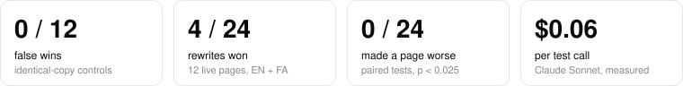
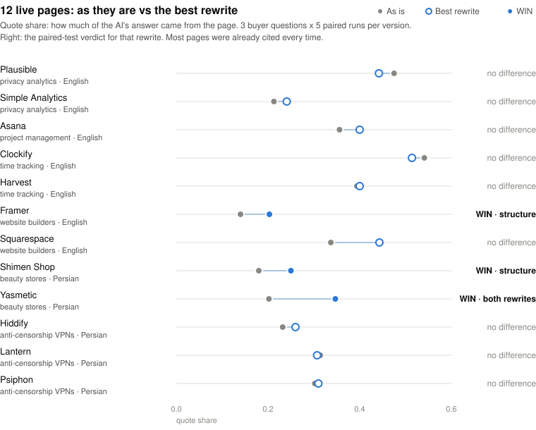

<p align="center">
  
</p>

<h1 align="center">Say My Name</h1>

<p align="center">
  <b>A Claude Code skill that tests whether AI answer engines would cite your page,<br>and keeps only the rewrites that measurably win.</b>
</p>

<p align="center">
  <a href="https://github.com/googool2/say-my-name/actions/workflows/test.yml"></a>
  <a href="CHANGELOG.md"></a>
  <a href="LICENSE"></a>
  <a href="#quick-start"></a>
</p>

---

**Your buyers have stopped searching. They ask.** "What's the best time tracker for a small team?" The answer names two or three products, and the rest don't exist.

**GEO advice is mostly guesswork.** Add statistics, add quotes, add an FAQ. Some of it helps, some does nothing, and some makes things worse. Nobody tells you which applies to *your* page.

**Say My Name measures it.** It puts your page next to real competitor pages, asks an AI answer engine your buyers' real questions, and counts how often your page is cited and how much of each answer it supplies. Then it tests rewrites against the original with paired statistics, and drops the ones that don't win.

No invented facts, no guessing. Persian and other RTL pages work out of the box.

**Make them say your name.**

<picture>
  <source media="(prefers-color-scheme: dark)" srcset="assets/stats-dark.svg">
  
</picture>

## What it does

Ask Claude **"will AI cite my page?"** and it:

| | |
|---|---|
| 🎯 **Sets up a fair fight** | your page, 3–6 competitor pages, and 3–8 real buyer questions in your page's language |
| 🤖 **Asks an answer engine** | every question several times, with the sources shuffled and anonymised as `[S1]…[Sn]` |
| 📏 **Measures** | how often you're cited, where, how much of the answer comes from your page, and whether your brand is named |
| ✍️ **Writes rewrites** | one idea per rewrite (answer-first, structure, statistics, quotations…) and never a fact that isn't already on your page |
| 🧪 **Tests them fairly** | the same questions, competitors and shuffles for every version, compared with paired significance tests |
| 🏆 **Reports a verdict** | WIN, WORSE, mixed, or no measurable difference. "Keep your page" is a valid answer |
| 🔤 **Speaks Persian** | catches Arabic ي/ك, missing ZWNJ (می‌ / ‌ها) and mixed digits, and matches brand spellings with or without a space |
| ↩️ **Applies safely** | writes a winner into a local `.md` page only after you see the diff, and undoes it byte for byte |

## Quick start

In Claude Code:

```
/plugin marketplace add googool2/say-my-name
/plugin install say-my-name@say-my-name
```

Then say **"test this page for AI visibility"** with a URL or a local file. It needs Python 3.10 or newer and a logged-in Claude Code. There is nothing else to install.

Every test shows its cost first and runs only after you say yes. A typical test is 15 calls (3 questions × 5 runs) at about $0.06 each with Claude Sonnet.

## How it works

1. **Prep** reads your page and the competitors. URLs are fetched politely: robots.txt is honored, there's a 1-second delay, and the user agent says who it is. Nothing on a website is ever changed.
2. **Baseline:** each run shuffles the sources, hides their names behind `[S1]…[Sn]`, and asks the engine to answer in at most 150 words with inline citations.
3. **Variants:** Claude writes 2–4 rewrites, each testing one idea. The script flags any number or quote that isn't on your page or in your facts file.
4. **Test:** each variant gets the same questions, the same competitors and the same shuffle seeds as the baseline, so every run has a direct pair.
5. **Report:** two paired tests are run on each variant. An exact McNemar test checks whether the page was cited. A sign test checks quote share. Each must reach p < 0.025, which keeps the overall false-win rate under 5%.

A real report, for Framer's home page against Squarespace, Wix and Webflow:

```
Say My Name report: 3 questions x 5 runs, 3 competitors, engine claude/sonnet
  version           cited   quote  brand  avg #   verdict
  baseline            87%    0.14    87%    3.4   -
  aa                  80%    0.12    80%    3.5   no measurable difference (citation p=1.000, quote share p=1.000; quote up in 7/15 runs, down in 8)
  answer-first       100%    0.22   100%    3.0   no measurable difference (citation p=0.500, quote share p=0.424; quote up in 9/15 runs, down in 5)
  structure          100%    0.20   100%    3.4   WIN (citation p=0.500, quote share p=0.013; quote up in 12/15 runs, down in 2)
```

`aa` is an identical copy of the page. It's there to show the noise: it should never win, and it didn't. `answer-first` looks better on average, but its gains weren't consistent across the paired runs. Only `structure` passed the test.

## Benchmarks

Everything below was run before release, and the plans for both real-page runs were [committed before the first call](bench/PHASE5-FULL-PLAN.md).

### Live pages

There were 12 live product pages in 6 niches: 7 in English and 5 in Persian. Each page was tested against the other pages in its niche, with 3 buyer questions × 5 runs × 4 versions, for 720 answers in total.

<picture>
  <source media="(prefers-color-scheme: dark)" srcset="assets/pages-dark.svg">
  
</picture>

| | result |
|---|---|
| identical copy (false-win check) | **0 wins out of 12** |
| real rewrites | **4 WIN**, 0 WORSE, 20 no measurable difference |
| English / Persian | 1 of 14 / 3 of 10 won |
| cost | $40.47 for 720 answers |

What it showed:
- **Most pages were already cited every time.** Citation couldn't rise any further, so every win came from quote share: the page supplied more of the answer.
- **Rewrites helped pages whose text was messy.** That means store home pages made of product tiles and countdown timers, and a home page built mostly from interface mockups. Pages that already read clearly gained nothing.
- **Nothing got worse,** so trying a rewrite is low-risk. But most rewrites didn't help either, which is exactly why every rewrite gets tested.

Full write-up: [bench/PHASE5-RESULTS.md](bench/PHASE5-RESULTS.md). There was also an earlier 4-page pilot: [bench/PHASE5-PILOT.md](bench/PHASE5-PILOT.md).

### Lab self-test

The lab self-test uses two hand-built fixtures, one English and one Persian, each with an identical copy, a planted improvement and a version with the useful facts stripped out. It checks that the instrument itself works.

| check | English | Persian |
|---|---|---|
| identical copy is not a win | ✅ | ✅ |
| planted improvement wins | ✅ | ✅ |
| stripped page does not win | ✅ | ✅ |
| repeated runs within 10 points | ✅ | ✅ |
| Persian typing issues found, brand found in Persian | | ✅ |

Results: [bench/RESULTS.md](bench/RESULTS.md). On every push, CI runs the same self-test with a free deterministic engine on Linux, macOS and Windows, with Python 3.10 and 3.14.

## Safety rules

- **Measure, don't guess.** A recommendation comes only from a report verdict.
- **Never invent facts.** A rewrite may reorder, clarify and restructure. It may add a number, quote or claim only if you gave it.
- **Ask before spending quota.** Every test shows its call count and cost, then waits.
- **Never edit a live site.** `apply` only writes local `.md`, `.mdx` and `.txt` files, after you've seen the diff. It refuses if the page changed since the test, and `undo` refuses if you edited the file afterwards.
- **Say what it can't show.** The report states the limits every time.

## Manual use

```bash
SMN="python skills/say-my-name/scripts/smn.py"
$SMN prep --page https://example.com/product --brand Acme --brand آکمه \
          --question "best invoicing app for freelancers?" --competitor https://rival.com ...
$SMN test                   # shows calls and cost; nothing runs
$SMN test --yes             # baseline
$SMN variant answer-first --from answer-first.txt
$SMN test answer-first --yes
$SMN report
$SMN apply answer-first     # diff only; add --yes to write a local page
$SMN undo
```

All state lives in `./.smn/`. Add `--engine fake` to any `test` to try the flow for free.

## Limits

- **It's a simulated engine.** It measures whether the AI cites and quotes your page *once the page is among the sources*. It doesn't measure whether ChatGPT, Perplexity or Google's AI search would find your page in the first place.
- **One engine so far:** Claude Sonnet, through the Claude Code CLI. Other models may weigh pages differently.
- **Small effects need more runs.** With 15 paired runs, only clear gains reach significance. A "no measurable difference" result is not proof that there is no effect.
- **Persian coverage is narrow.** It was tested on two niches whose pages are hosted outside Iran, because most Iran-hosted sites refused connections from the test network.
- Tested on Windows. CI covers Linux and macOS with the fake engine only.

## Versions and roadmap

See [CHANGELOG.md](CHANGELOG.md), which also explains how the test data changed the skill.

Next:
- more engines (OpenAI, Gemini) behind the same report;
- a retrieval step, to test whether the page would be found as well as cited;
- testing several pages of one site together.

## License

MIT
